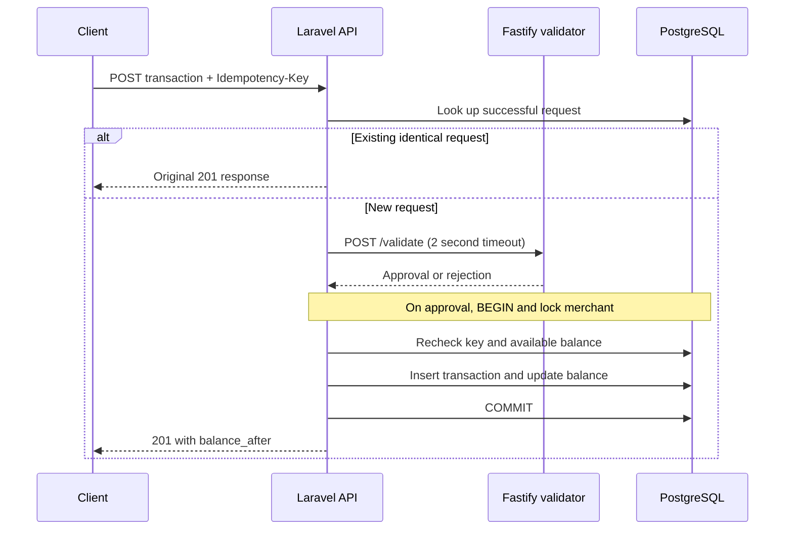

# Payment Ledger

Laravel 12 API, TypeScript/Fastify validator, and PostgreSQL assignment.

Work is tracked in the [Payment Ledger project](https://github.com/users/albrtblzs/projects/4).

## Development workflow

- Keep `master` as the integration branch.
- Before starting an issue, create `feature/<issue-number>-<short-name>` and move the issue to In Progress.
- Implement and verify only that issue's scope.
- Open a pull request targeting `master` with `Closes #<issue-number>` and validation evidence.
- Keep issues In Progress until their pull requests are merged. Squash-merge automatically after relevant checks pass, as authorized by the repository owner.

See the repository issues for the implementation plan and acceptance criteria.

## Run locally

Prerequisites: Git and Docker Desktop with Linux containers (Docker Compose v2).

```sh
git clone https://github.com/albrtblzs/bbox.git
cd bbox
docker compose up --build -d --wait
```

The API is available at http://localhost:8000; its health endpoint is `/up`.
The validator's `/health` endpoint and PostgreSQL are available only inside the Compose network.
Merchant creation, retrieval, transaction posting and transaction history are available.

Startup generates a container-local Laravel key and runs migrations after PostgreSQL is healthy.
PostgreSQL data persists in a named volume. `docker compose down` stops the services without deleting data.
The PHP development server and example database credentials are intended for this local assignment.

Optionally copy `.env.example` to `.env` to change the exposed API port or validator limit settings.
The limits are positive integer minor-unit amounts, defaulting to 1,000,000 per currency. Invalid settings fail validator startup.

## Checks

Create the dedicated test database once (the test suite resets this database):

```sh
docker compose exec database createdb -U ledger ledger_test
```

```sh
docker compose exec backend php artisan test
docker compose exec validator npm test
docker compose exec validator npm run typecheck
docker compose exec validator npm run build
```

Dependency lockfiles are committed. Dependencies are installed inside images; do not commit `vendor`, `node_modules`, `.env`, logs, or generated build files.

## Ledger storage

Merchants have one immutable EUR/USD/HUF currency and an integer balance in hundredths of that currency.
Balances range from 0 to 9,007,199,254,740,991 (the largest exact JavaScript integer).
Transaction amounts range from 1 to 2,147,483,647; the validator imposes a lower configurable business limit.
Transactions contain a `balance_after` snapshot for replaying the original successful response.
PostgreSQL enforces amounts, balance bounds, transaction types, matching merchant currency, and merchant-scoped idempotency-key uniqueness.
Merchant deletion is restricted while ledger entries reference it.

## Merchant API

Create a merchant with a name (1–255 characters after trimming) and uppercase EUR, USD, or HUF currency.
The initial balance is always zero; clients cannot supply a starting balance.

```sh
curl -X POST http://localhost:8000/api/merchants \
  -H 'Content-Type: application/json' \
  -d '{"name":"Example Shop","currency":"EUR"}'
curl http://localhost:8000/api/merchants/1
```

Creation returns HTTP 201 and retrieval HTTP 200. Both use the same response shape:

```json
{"data":{"id":1,"name":"Example Shop","currency":"EUR","balance":0,"created_at":"2026-11-08T00:00:00.000000Z","updated_at":"2026-11-08T00:00:00.000000Z"}}
```

API errors are JSON even without an Accept header. Invalid input returns HTTP 422 with
`error.code: INVALID_INPUT`, `error.message`, and field errors in `error.details`.
Missing merchants return HTTP 404 with `error.code: NOT_FOUND` and `error.message`.

## Post a transaction

```sh
curl -X POST http://localhost:8000/api/merchants/1/transactions \
  -H 'Content-Type: application/json' -H 'Idempotency-Key: payment-001' \
  -d '{"type":"payment","amount":10000,"currency":"EUR"}'
```

Use `refund` to debit the available balance. Amount must be a positive JSON integer; strings and fractions are rejected.
The required header accepts 1–128 letters, digits, `.`, `_`, `:`, or `-`.
HTTP 201 returns `data` with the transaction ID, merchant ID, type, amount, currency, `balance_after`, and UTC timestamps.
An identical key/input replays that original body and 201 status even if the validator is down.
A changed valid input for an existing key returns 409 `IDEMPOTENCY_CONFLICT`.
Only successful transactions reserve keys. After a 503, retry with the same key.

The validator is called outside the database transaction with a two-second timeout, no redirects, and no automatic retries.
An approved request locks the merchant row, rechecks the key, and inserts the transaction and updates the balance in one transaction.
Refunds with insufficient balance return 422 `INSUFFICIENT_FUNDS`; unsafe balance growth returns 422 `BALANCE_LIMIT_EXCEEDED`.
Validator rejection returns 422 `VALIDATOR_REJECTED`; outages, non-success responses and invalid decision bodies return 503 `VALIDATOR_UNAVAILABLE`.
Validation logs contain a generated correlation ID, latency and outcome, without request bodies.

## Transaction history

`GET /api/merchants/{id}/transactions?page=1` returns only that merchant's entries, newest first by creation time then ID.
Pages contain at most 20 entries using the same transaction resource as posting, plus Laravel `links` and `meta` pagination fields.
`page` must be a positive integer up to 2,147,483,647. Empty histories and pages beyond the last page return an empty `data` array.

## Test strategy and CI

`php artisan test` uses Pest and runs the existing PHPUnit feature tests plus Pest concurrency scenarios.
All database tests explicitly select `ledger_test`. The concurrency suite launches two separate PHP HTTP kernels
and synchronizes both validator responses before allowing posting, exercising actual PostgreSQL row locks.
It covers duplicate payments, conflicting payloads sharing a key, and competing full-balance refunds.
The feature suite also injects a database update failure to prove the transaction insert rolls back.
Run the suite sequentially; its dedicated database is reset during tests.

GitHub Actions runs Docker startup, backend tests (including races), PHP style, validator tests/types/build, and the real HTTP healthy/outage/recovery smoke phases on PRs to `master` and pushes to `master`.

## Architecture and decisions



- Laravel owns ledger state; the small stateless validator owns configurable fraud-check rules. A synchronous HTTP boundary keeps the assignment easy to run and explain.
- Amounts use hundredths for all supported currencies, including HUF, as a project convention. There is no currency conversion or multi-currency balance.
- The stored balance makes reads simple. Row locking serializes writes for one merchant, while different merchants can post independently. The database transaction commits the ledger entry and balance together.
- A unique key is scoped to a merchant and retained with successful entries indefinitely. Replays compare type, amount and currency, and use the stored response balance. Concurrent duplicates may validate twice, but post once.
- Rejections and infrastructure failures do not create ledger records or reserve keys. Validator failure returns 503 rather than accepting unchecked money movement; the caller can retry the same key.
- Refunds debit available merchant balance. They do not reference an original payment or enforce per-payment cumulative refund limits.
- HTTP controllers handle transport, FormRequests validate input, resources serialize responses, and the transaction service owns orchestration. Database constraints provide a final integrity boundary.

## API reference

| Method and path | Input | Success |
| --- | --- | --- |
| `POST /api/merchants` | `name`, `currency` | 201 merchant |
| `GET /api/merchants/{id}` | None | 200 merchant |
| `POST /api/merchants/{id}/transactions` | `type`, integer `amount`, `currency`; `Idempotency-Key` header | 201 transaction or identical replay |
| `GET /api/merchants/{id}/transactions?page=1` | Optional positive `page` | 200 transaction page |
| Internal `POST /validate` | `type`, integer `amount`, `currency` | 200 `{approved:boolean,reason:string}` |

| HTTP status | Error code | Meaning |
| --- | --- | --- |
| 422 | `INVALID_INPUT` | Invalid fields/header or merchant currency mismatch |
| 422 | `VALIDATOR_REJECTED` | Fraud-check rule rejected the request |
| 422 | `INSUFFICIENT_FUNDS` | Refund exceeds available balance |
| 422 | `BALANCE_LIMIT_EXCEEDED` | Payment exceeds the safe stored balance limit |
| 409 | `IDEMPOTENCY_CONFLICT` | Key already used for different valid input |
| 503 | `VALIDATOR_UNAVAILABLE` | Timeout, connection failure, non-success status or invalid decision |
| 404 | `NOT_FOUND` | Merchant or API route not found |

## HTTP acceptance check

With the default validator limits, run the committed smoke script in a one-off container.
This creates a test merchant in the application database and verifies actual HTTP merchant creation, payment, refund,
original-response replay, conflict, insufficient funds, validator rejection and history. It prints the created merchant ID.

PowerShell:

```powershell
Get-Content scripts/smoke.mjs -Raw | docker compose run --rm --no-deps -T validator node --input-type=module
```

Bash:

```sh
docker compose run --rm --no-deps -T validator node --input-type=module < scripts/smoke.mjs
```

To verify outage and recovery in PowerShell, replace `1` with the ID printed above:

```powershell
docker compose stop validator
Get-Content scripts/smoke.mjs -Raw | docker compose run --rm --no-deps -T -e SMOKE_MODE=outage -e SMOKE_MERCHANT_ID=1 validator node --input-type=module
docker compose start validator
# Wait until docker compose ps reports the validator healthy.
Get-Content scripts/smoke.mjs -Raw | docker compose run --rm --no-deps -T -e SMOKE_MODE=recovery -e SMOKE_MERCHANT_ID=1 validator node --input-type=module
```

The outage check confirms a new request returns 503 without changing balance and a completed request still replays.
Recovery retries the same previously unsuccessful key and confirms exactly one credit.
Run these phases once per new smoke merchant; they expect the balances established by the healthy phase.

## Limitations and further work

The requested assignment features are implemented. This is a local demonstration, not a production payment platform.
Authentication/merchant authorization, TLS, production PHP workers, secret management, and deployment are outside scope.
The API port is exposed on the host; run it in a trusted local environment. The validator and database have no published host ports.
Default Laravel starter files remain but the API does not require a frontend build.

With more time, add authentication, immutable database-level ledger permissions, audit records for rejected attempts,
reconciliation between entries and balances, monitoring/alerting, bounded lock waits, and deployment hardening.
Consider refund-to-payment links, currency-specific minor-unit metadata, cursor pagination, and an asynchronous review flow only if business requirements call for them.
The application key is container-local and regenerated on recreation; persistent encryption keys would be required before storing encrypted production data.
No PHPStan configuration is included; strict TypeScript checks and PHP formatting are provided alongside behavioral tests.

## Submission verification

Verified from a fresh checkout with a new PostgreSQL volume: Docker startup, automatic migrations,
all service health checks, and the healthy/outage/recovery HTTP smoke phases.
The test suite contains 72 passing backend tests (407 assertions), including three actual concurrent-process races,
plus five passing validator tests, strict TypeScript checks and a production TypeScript build.
